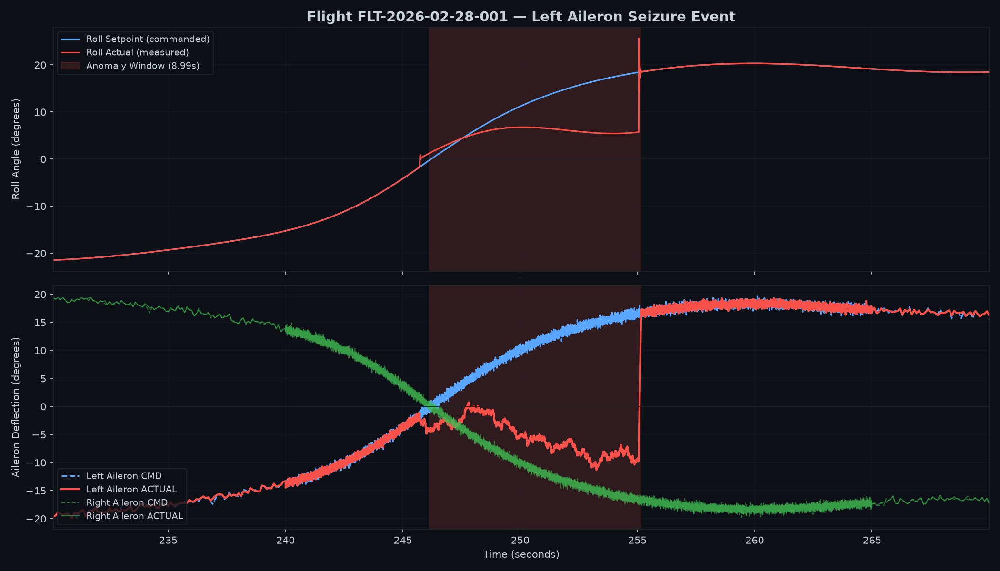
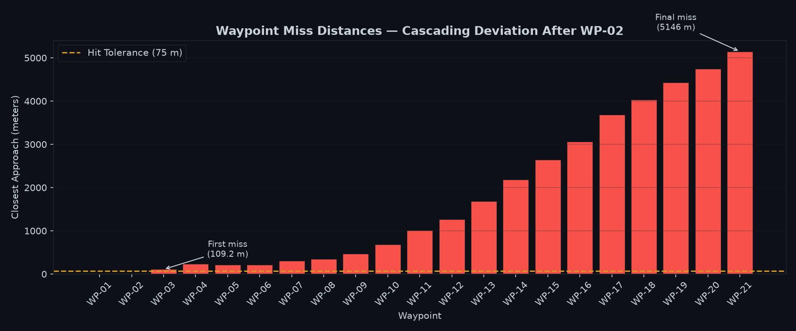
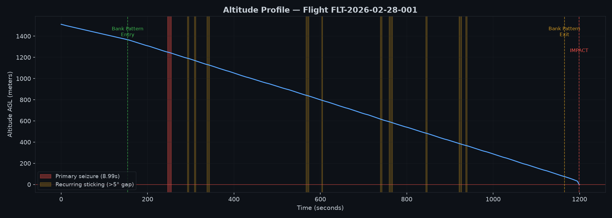
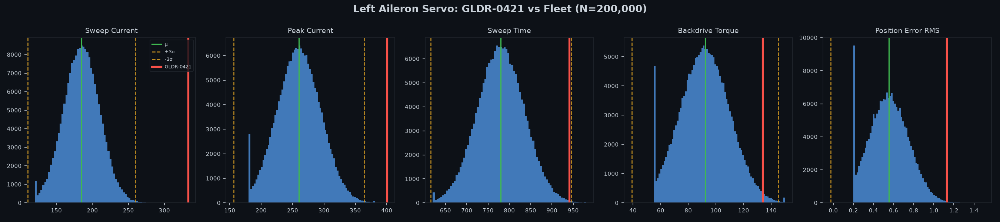
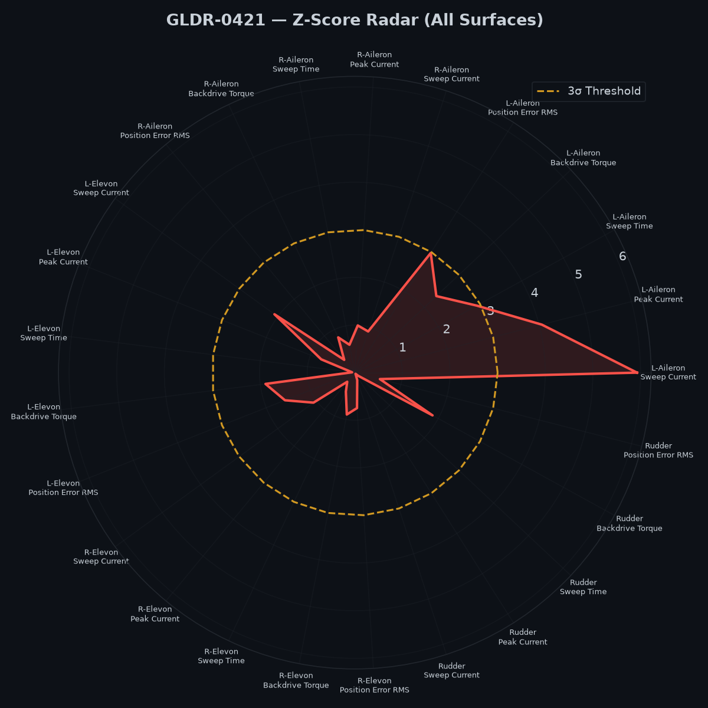

# GLDR-0421 Glide Test Failure — Investigation Report

**Flight:** FLT-2026-02-28-001 · **Vehicle:** GLDR-0421 (SN-12661455) · **Author:** Andrea Lukas · **Date:** 2026-10-12

---

## 1. Executive Summary

**The failure was caused by manufacturing.** The left aileron servo on GLDR-0421 (ActuMax SM-14, serial SV-65031081, lot L2026-07B) had abnormally high internal friction. At Waypoint 2 (t = 246 s) the autopilot commanded a right bank. The left aileron stayed stuck near −5° to −10° for **9.0 seconds** while it was being commanded to about +16°. It then snapped free in about 100 ms. That is a textbook stiction breakaway. The aircraft missed WP-03 by 109 m. Because it is an unpowered glider, it could not recover the lost energy and position, and every later waypoint was missed by a growing margin, up to 5.1 km. The same servo stuck again **11 more times** later in the flight.

The defect was present on the factory bench before the flight. At final test, this servo drew **332.7 mA sweep current, +5.93σ above the 200,000-unit fleet mean** (185.1 mA). It was the **highest of all 200,000 vehicles**. A reading that high from normal variation has odds of about 1 in 650 million. Peak current was also extreme (+4.05σ). The unit still **passed QC**, because the quality gate never compares bench measurements against any limit. **All 200,000 units in the database passed**, including 32,296 that had logged QC exceptions.

**Recommendations**

1. **Do not just repeat the test with other production units.** The data shows one more unit built with the same signature (GLDR-200000: 304.2 mA, +4.78σ, built at a different plant from a different servo lot). It should be held now.
2. **Add a two-tier statistical check (SPC) on 25 servo bench measurements (Section 6):**
   - **QUARANTINE (blocks shipment):** a combined friction score on any one servo of D ≥ 6.0, or any single measurement ≥ 5.5σ. On the current fleet this holds exactly **2 of 200,000 units**: GLDR-0421 and GLDR-200000. The expected false-alarm rate is under 0.1 units per 200,000.
   - **FLAG (does not block):** any measurement ≥ 3σ. These units (3.25%) feed lot, line, and shift trend charts instead of being reviewed one by one.
3. **Fix the gate logic.** A unit with logged QC exceptions should not be able to receive `final_qc_pass = 1`.

---

## 2. Problem Statement

| | |
|:--|:--|
| **What** | GLDR-0421 left its planned path during an autonomous, unpowered glide test and hit the ground about 5 km from the intended track |
| **When** | 2026-02-28. The deviation began at t = 246 s (WP-02). Impact was at t = 1198.9 s |
| **Plan** | 21 waypoints in a descending pattern, each with a 75 m hit tolerance |
| **Result** | WP-01 hit (1.21 m) and WP-02 hit (1.30 m). WP-03 missed by 109 m, and WP-04 to WP-21 missed by 230 m to 5,146 m |
| **Pre-flight status** | `final_qc_pass = 1`, `qc_exception_count = 0`, one rework (R05: firmware and parameter reflash) |

For the first 246 s the aircraft flew with sub-2-meter accuracy. That rules out anything present from release, such as a dead component, a basic design flaw, or a bad drop. Whatever went wrong was **latent** and only appeared under a specific load.

---

## 3. Flight Investigation

**Method.** Before looking at the data, I listed every possible cause across the six standard categories of an Ishikawa (fishbone) diagram: people, machine, method, material, measurement, and environment. I then tested each one against the telemetry (500 Hz, 600,000 rows) and the flight plan. This keeps the analysis from anchoring on engineering's early suspicion. The full fishbone, fault tree, and 5 Whys are in [`docs/root_cause_analysis.md`](docs/root_cause_analysis.md).

### 3.1 Timeline

| Time | Event |
|:--|:--|
| 0–200 s | Release at about 1,510 m above ground. Stable glide. WP-01 hit within 1.21 m |
| 200–246 s | A −20° left bank flown cleanly, so the airframe has enough roll control. WP-02 hit within 1.30 m |
| **≈246.0 s** | Autopilot begins a smooth bank reversal to the right. The left aileron command ramps from negative through 0° toward +16°. **When the command reverses direction, the left aileron stops following.** It hangs at about −4° while the command passes through zero. Sticking that starts at a direction reversal is typical of static friction |
| 246–255 s | The left aileron stays at −3° to −10° while the gap to its command grows to **27.8°**. The roll controller is saturated for 64% of this window. The right aileron (same power bus) tracks within 1.3°. Roll stalls near +6° against a +18° target |
| **255.1 s** | Breakaway. The aileron jumps from −9.7° to +16.9° in about 100 ms, the classic signature of static friction suddenly letting go |
| 292 s | WP-03 missed by 109 m |
| 292–940 s | **11 more sticking episodes** with a >5° command gap (starting at t = 293, 308, 338, 567, 604, 739, 759, 844, 921, 925, 936 s), each up to 17° and lasting up to 8 s |
| 1165–1182 s | Bank pattern ends. At 1182 s the autopilot enters `FAILSAFE` (reason: `NAV_PATH_DEVIATION`), a *result* of the accumulated off-track error |
| 1198.9 s | Ground impact about 5 km off track |

### 3.2 Evidence



**Fig 1. The left aileron seizure at WP-02.** Top: the roll setpoint (blue) rises to +18°, but actual roll (red) stalls near +6° for the whole shaded window. Bottom: the left aileron command (blue) climbs smoothly while the actual position (red) is stuck between −3° and −10°, then snaps to the command at 255.1 s. The right aileron (green) tracks its command throughout, so power, wiring, and software are all working.



**Fig 2. Waypoint miss distances.** Both hits before the event were within 2 m. Every waypoint after it was missed, and the error kept growing. A glider has no engine to recover lost position, so a 9-second loss of control early in the flight compounds for the rest of it.



**Fig 3. Altitude profile.** The descent rate stays steady through the event. The aircraft did not stall or dive; it glided normally on the wrong track. Red marks the primary seizure and amber marks the 11 later sticking episodes. Recurring sticking points to a defect that is always present in the servo, not a one-off transient.

### 3.3 Causes ruled out

| Possible cause | Test | Result |
|:--|:--|:--|
| Pilot / operator | Control mode (`control_mode`) | `AUTO_STABILIZE` from release until 1182 s, with no manual input. The failsafe came 936 s after the deviation started. **Ruled out** |
| Autopilot software | Was the right command issued? | The roll setpoint and left aileron command ramp smoothly and consistently (to about +18° at 255 s), the same way they did for the earlier left bank. The right aileron's command mirrors the left. **Ruled out** |
| Aerodynamic design / flight plan | Could the airframe fly the maneuver? | The same ±20° bank was flown 46 s earlier, hitting WP-02 within 1.3 m. **Ruled out** |
| Wind / weather | Wind, acceleration, temperature | Wind 1.1–3.7 m/s between 200 and 300 s, vertical acceleration 8.7–10.3 m/s² (no gust spikes), 7.9–11.9 °C (no icing). Roll error before the event was below 0.02°. **Ruled out** |
| Sensors (IMU / GPS) | Sensor health | `attitude_valid = 1` throughout, 3D GPS fix with 6–15 satellites, HDOP 0.97 or lower. **Ruled out** |
| Servo position sensor reporting wrong values | Did the aircraft respond as if the surface moved? | Roll stalled at about 6°, so the surface really did not move. **Ruled out** |
| Power / wiring | Bus voltage; the right aileron is on the same bus | Servo bus 12.26 V or higher during the event, no brownout, and the right aileron worked normally. **Ruled out** |
| External linkage or hinge binding | Assembly measurements | Hinge torque 37.07 N·mm (looser than average), freeplay 0.276 mm, screw torque 0.692 N·m, all normal. **Ruled out** |
| **Internal servo defect** | Bench data (Section 4) | **Confirmed** |

The servo's current draw during the event (about 0.39 A, against 0.34 A before it) rose only slightly while the surface was stuck. That fits a motor pushing against mechanical resistance, not an electrical fault.

---

## 4. Manufacturing Investigation

### 4.1 Unit traceability

| Field | Value |
|:--|:--|
| Vehicle / serial | GLDR-0421 / SN-12661455 |
| Build | 2026-02-06, HB-PLANT-1, Line LN3, Shift B |
| Suspect part | Left aileron servo: ActuMax SM-14, SV-65031081, lot L2026-07B |
| Rework | 1 × R05: *"Updated firmware + parameter profile; repeated self-test."* |
| QC | `final_qc_pass = 1`, `qc_exception_count = 0` |

### 4.2 Bench test results against the fleet (N = 200,000)

Every vehicle's five servos (left and right elevon, left and right aileron, rudder) go through a bench sweep test with 9 measurements each. I compared GLDR-0421 with the full fleet using Z-scores, Z = (x − μ) / σ.

| Left aileron metric | GLDR-0421 | Fleet μ | Fleet σ | **Z** | Fleet rank |
|:--|--:|--:|--:|--:|--:|
| Sweep current (mA) | 332.70 | 185.12 | 24.89 | **+5.93** | **1st of 200,000** |
| Peak current (mA) | 400.32 | 260.08 | 34.59 | **+4.05** | **1st of 200,000** |
| Position error RMS (°) | 1.128 | 0.553 | 0.193 | +2.98 | 401st |
| Sweep time (ms) | 940.89 | 780.04 | 55.04 | +2.92 | 341st |
| Backdrive torque (N·mm) | 133.68 | 92.14 | 17.69 | +2.35 | 2,073rd |

Taken together, these readings describe a servo that needs much more current to move and that moves more slowly and less precisely. That is the signature of **excess internal friction in the gearbox**. The bench recorded it on 2026-02-06, three weeks before the flight. Only **2 of 200,000** servos drew more than 300 mA of sweep current.



**Fig 4. Left aileron bench measurements, GLDR-0421 (red) against the fleet.** Dashed lines mark ±3σ. Sweep current and peak current sit far beyond the right-hand tail of the fleet. Sweep time and position error sit at the edge of the tail.



**Fig 5. GLDR-0421 |Z| for 25 bench measurements (5 servos × 5 metrics).** The dashed ring is 3σ. Only the left aileron goes past it. All four other servos are within |Z| < 2.6 on every metric, so the defect is in this one servo and not the vehicle as a whole.

### 4.3 What it is not

- **Not a bad supplier lot.** Lot L2026-07B (5,784 units) has a normal average sweep current, so this is a single defective unit. This matters for containment: we do not need to recall the lot, but we do need to screen individual units, because single-unit defects will keep happening.
- **Not an assembly error.** All installation measurements for this unit are normal (Section 3.3).
- **Not unique.** **GLDR-200000** shows the same signature: 304.2 mA sweep current (+4.78σ) and 367.7 mA peak current, built 2026-02-18 at OC-PLANT-2 with servo lot L2026-02B. Its plant, lot, and rework history all differ from GLDR-0421, which again points to random single-unit defects that only screening each unit can catch. **This vehicle should be held and its left aileron servo pulled for teardown.**
- **A borderline group to retest.** Scanning the fleet for the same pattern (sweep current *and* peak current both ≥ 3σ on one servo) finds 10 vehicles. GLDR-0421 (+5.93 / +4.05) and GLDR-200000 (+4.78 / +3.11) stand well clear. The other 8 sit just over the line (3.0–3.6σ on both readings), across all five servo positions. If the two readings are independent, about 2 such units would be expected by chance, so these 8 may include milder cases of the same defect. They don't meet the QUARANTINE limit, but they should be first in line for bench retest. (Listed in `manufacturing_analysis.py` output, step [7].)

---

## 5. Why Quality Missed It

1. **Measurements are recorded but never judged.** The bench writes sweep current, peak current, sweep time, and the other measurements to `manufacturing.csv`, but the pass/fail decision only checks whether the sweep finished without a hardware fault code. A servo drawing 1.8× the normal current finishes the sweep and passes.
2. **A 100% pass rate.** `final_qc_pass = 1` for **200,000 of 200,000** units, and `scrap_flag = 0` for all of them. Any real gate on a high-volume line rejects something. A 100% yield means the gate is not screening anything.
3. **Logged exceptions don't block shipment.** **32,296 units (16%)** have `qc_exception_count > 0` with codes such as E02, E07, E11, E15, and E21, yet every one of them passed. GLDR-0421 had no exceptions, but this shows the gate's logic is broken beyond the missing limits.
4. **A rework that missed a chance.** GLDR-0421 was reworked once (R05: firmware and parameter reflash, then a repeated self-test). R05 is common (about 9,600 units), so it is not suspicious by itself. But a reflash followed by a passing self-test checks the software state, not the mechanical health of the servo. No step after rework compares the bench numbers again.

**5 Whys (summary)**

1. The aircraft crashed because it lost lateral control at WP-02 and, without an engine, could not recover.
2. It lost control because the left aileron servo stuck for 9 s.
3. The servo stuck because of excess internal friction, which the bench recorded at +5.93σ sweep current.
4. A +5.93σ servo shipped because the QC gate has no limits on bench measurements.
5. The gate has no limits because the quality system only asks whether a part works at all, not whether it performs like its peers. **This is the root cause in the process: the factory collects the right data and never analyzes it.**

---

## 6. Prevention and Detection Approach

### 6.1 Approach: two-tier SPC on the servo bench data

Statistical process control (SPC) uses Shewhart control charts, a standard method in manufacturing quality for about a century. The idea: in a stable process, measurements of identical parts form a predictable distribution, and a unit far out in the tail signals a specific cause that should be investigated. It is deterministic, easy to explain, and easy to audit, which is what a flight-safety gate needs. It doesn't need to know why a servo is stiff. It only needs to notice that one servo behaves unlike the other 200,000.

**Measurements screened (25):** sweep current, peak current, sweep time, position error RMS, and backdrive torque, for each of the 5 servos.

#### What the defect signature looks like

A servo with internal friction has to work harder and moves worse. On the bench, that shows up as **all five measurements on the same servo running high at once**. Both known defect units show it:

| | Sweep current | Peak current | Sweep time | Position error | Backdrive torque | Combined score *D* |
|:--|--:|--:|--:|--:|--:|--:|
| GLDR-0421, left aileron | +5.92 | +4.03 | +2.92 | +2.88 | +2.32 | **8.57** |
| GLDR-200000, left aileron | +4.78 | +3.09 | +2.98 | +2.10 | +2.79 | **7.31** |
| Next-highest servo in the fleet | | | | | | 5.80 |

*(Z-scores are the robust high-side values defined below.)*

Across the 200,000 healthy units these five measurements are **uncorrelated** (|r| ≤ 0.01). On a healthy servo, a high sweep current says nothing about its peak current. So when several of them are high together on one servo, chance is a very poor explanation. That is the signal the gate is built around.

#### How a vehicle is scored

1. **Robust baseline.** For each of the 25 measurements, the center is the fleet median and the spread is σ̂ = IQR / 1.349. These are frozen from a reference set of units (Section 6.2).
2. **High side only.** z = max(0, (x − median) / σ̂). Every failure mode here, whether more current, slower movement, more error, or stiffer backdrive, shows up as a high reading. The low end is also cut off at the instrument floor, so it can't be measured reliably.
3. **Combined score per servo.** D = √(z₁² + z₂² + z₃² + z₄² + z₅²) across that servo's 5 measurements. Since the measurements are independent, the false-alarm rate of D is known in advance. No machine learning is involved; it's one more line of arithmetic, and the dashboard can show each servo's z values next to its D.
4. **Verdict:**

| Tier | Rule | Action | Fleet result |
|:--|:--|:--|--:|
| **QUARANTINE** | Any servo with **D ≥ 6.0**, or any single **z ≥ 5.5** | **Block shipment.** Retest the servo, replace it if the result repeats, and require an engineer's sign-off to release | **2** (GLDR-0421, GLDR-200000) |
| **FLAG** | Any z ≥ 3, any D ≥ 4.5, or any reading stuck at the instrument limit | Ships. Logged with the reason. Feeds the trend charts by lot, line, and shift (below) | 6,498 (3.25%) |
| **PASS** | Everything else | — | 193,500 |

Both QUARANTINE limits are set so that **fewer than 0.1 false alarms are expected across all 200,000 vehicles**. For D, that's a per-servo false-alarm rate of 1×10⁻⁷. Both known defect units clear the limit easily.

#### Why this replaced the first version (single |Z| ≥ 4.5)

The first version quarantined 14 units, and 12 of them were there only because of a high **position error** reading. Three problems caused this:

- **Clipped readings.** Every measurement is pinned at an instrument floor (4% of position-error readings sit exactly at 0.2°). This shrinks the standard deviation slightly (0.193 vs a robust 0.201), which inflates Z exactly where the limit sits. Switching to the robust spread cut quarantines from 14 to 7.
- **Single readings at 4.5σ are expected by chance.** With 25 tests on 200,000 vehicles (5 million readings), about 17 readings past 4.5σ are expected even if every servo is healthy. The 5 servos left that were high on position error alone were at 4.5–4.7σ, which is consistent with chance. None of them showed the friction signature (their other measurements were below 2.4σ). They now go to FLAG.
- **One limit per measurement can't see a combined pattern.** GLDR-200000's peak current (+3.09) and sweep time (+2.98) would each pass alone. Together with its sweep current, they make a clear signature that the combined score D picks up.

The **two-tier structure stays the same**. What changed is how each tier is decided: a robust spread instead of the plain standard deviation, high side only, and a combined score per servo for QUARANTINE.

#### What FLAG is for

The FLAG count (6,484 units with some z ≥ 3) is almost exactly what chance predicts for 25 tests per vehicle (about 6,640). So **a single FLAG on a single unit is mostly noise**, and treating it as a reason to stop that unit would recreate the rubber-stamp problem. FLAG is instead **the input to the process-level control chart (a p-chart)**: track the FLAG rate per servo lot, line, shift, and plant against the 3.25% baseline. A lot running at 6% is a supplier problem even if no single unit has crossed the QUARANTINE line. Flight test can still use the FLAG reasons as a go/no-go cross-check.

#### Readings stuck at the instrument limit

Backdrive torque tops out at 150 N·mm, and sweep time at 980 ms. **731 vehicles** have at least one reading at that ceiling, so their true value is unknown and may be higher. All of them already FLAG on z ≥ 3. They are tagged `SATURATED` so quality can see them, and the fixture's range should be extended so these servos can actually be measured.

### 6.2 Making it work in production

- **Fixed baseline limits.** Compute μ and σ once from a fixed reference group of units and version-control them. Do not recompute them from the live data stream, or a slow drift would quietly widen the limits. Review the limits quarterly or after any process change.
- **Run at the bench, not afterward.** Score each servo when it is tested, before it is installed, so a stiff servo goes back to stock instead of onto an airframe. Score the vehicle again at final QC.
- **Re-screen after any rework.** Any rework sends the unit back through the SPC check.
- **Fix the exception logic.** A unit with `qc_exception_count > 0` cannot reach `final_qc_pass = 1` without a recorded engineering decision.
- **Screen the units already built.** Run the detector over all 200,000 units now. The 2 QUARANTINE units, **GLDR-200000** and the already-lost GLDR-0421, need action now. Rank the FLAG list by D so the highest-scoring servos get retested before any flight.

### 6.3 Future work (Phase 2, after the gate is in place)

- **Full covariance:** the combined score D assumes the measurements are independent, which holds in this data today. If a process change introduces correlation, switch to the full Mahalanobis distance, which accounts for it.
- **Censored-data estimates:** fit the baseline with methods that treat the floor and ceiling readings as "at least" or "at most" values, rather than relying on the IQR alone.
- **Drift rules:** Western Electric run rules on lot and shift averages, to catch a supplier drifting before any single unit crosses a limit.

As discussed with the Head of Ops, these come after the basic process is fixed. A simple Z-score gate captures most of the value with a fraction of the effort.

---

## 7. Tools Built

> *Part 2 tools are in progress. This section will be completed when they ship.*

| Tool | Purpose | Status |
|:--|:--|:--|
| `analysis/flight_investigation.py` | Part 1 investigation: builds the flight timeline (state, mode, and events), scores the waypoints, detects every left-aileron sticking episode, computes each rule-out test from telemetry (mode, software, power, position sensor, wind/temperature, GPS/attitude), and produces Figs 1–3 | Done |
| `analysis/manufacturing_analysis.py` | Traces the crashed vehicle (`--vehicle`, default GLDR-0421) to its build record. Computes Z-scores for all 5 servos, the supplier lot check, a scan listing every vehicle with the same friction signature, and the QC gap figures (pass rate, exceptions that still passed, R05 count). Produces Figs 4–5. It is an investigation tool; the production gate is `spc_detector.py` | Done |
| `spc_detector.py` | Command-line tool: scores every vehicle (robust high-side z, combined score D per servo) and outputs PASS / FLAG / QUARANTINE with the reason codes (`SIGNATURE`, `EXTREME`, `HIGH`, `SATURATED`) as CSV or JSON | Planned |
| Production health dashboard | Three tabs: Fleet Overview (floor leads), SPC Charts (quality), Vehicle Lookup (flight test go/no-go) | Planned |

**Running the Part 1 investigation** (from the repository root, with `telemetry.csv`, `flight_plan.csv`, and `manufacturing.csv` present; Python 3.9 or later):

```bash
pip install matplotlib numpy
python3 analysis/flight_investigation.py                         # about 1 min, writes Figs 1–3
python3 analysis/manufacturing_analysis.py --vehicle GLDR-0421   # about 1 min, writes Figs 4–5
```

Every number in Sections 3–5 is printed by one of these two scripts:

| Script step | Report evidence |
|:--|:--|
| `flight_investigation.py` [3] Timeline | State changes, `FAILSAFE` at 1182 s, impact at 1198.9 s |
| [4] Waypoint results | WP-01/02 hits, WP-03 to WP-21 misses (Fig 2) |
| [5] Anomaly analysis | Primary seizure 246.1–255.1 s, 27.8° gap, the 11 later episodes with times |
| [6] Hypothesis testing | Every row of the ruled-out table in §3.3 |
| `manufacturing_analysis.py` [2]–[4] | Build record, servo traceability, Z-scores for all 5 servos (§4.1–4.2) |
| [6] Lot check | L2026-07B is not shifted (§4.3) |
| [7] Same-signature scan | GLDR-200000 and the 8 borderline units (§4.3) |
| [8] QC gap | 100% pass, 32,296 passed with exceptions, R05 count (§5) |

Outside the event window, `flight_investigation.py` reads telemetry at 10 Hz (every 50th row); inside 240–265 s it reads every row at 500 Hz. The values above come from that sampling.

---

## 8. Limitations

- **No teardown.** The friction mechanism (tight gear mesh, contamination, dry lubricant) comes from the electrical and timing signature, not a physical inspection. Tearing down GLDR-200000's servo would confirm it.
- **Telemetry episode count.** The "11 later episodes" figure uses 10 Hz decimated data, with gaps under 0.5 s merged. At the full 500 Hz there are about 21 separate segments with a >5° gap.
- **Fleet statistics include the outliers.** μ and σ are computed over all 200,000 units, defect units included. A cleaned baseline would make the Z-scores of real outliers slightly larger.
- **Independence assumption.** The false-alarm math for D relies on the bench measurements being uncorrelated. That's true in the current data (|r| ≤ 0.01), but the detector should check it whenever the baseline is refrozen.
- **Only two confirmed defects.** The QUARANTINE limits are justified by false-alarm math, not tuned on many known failures. Teardown results from QUARANTINE and high-D FLAG units should be used to check them.

---

*Supporting documents: [`docs/root_cause_analysis.md`](docs/root_cause_analysis.md) (full fishbone, fault tree, 5 Whys) · [`docs/reviewed_questions_answers.md`](docs/reviewed_questions_answers.md) (SPC background and tool design notes) · [`docs/HANDOFF_SUMMARY.md`](docs/HANDOFF_SUMMARY.md)*
