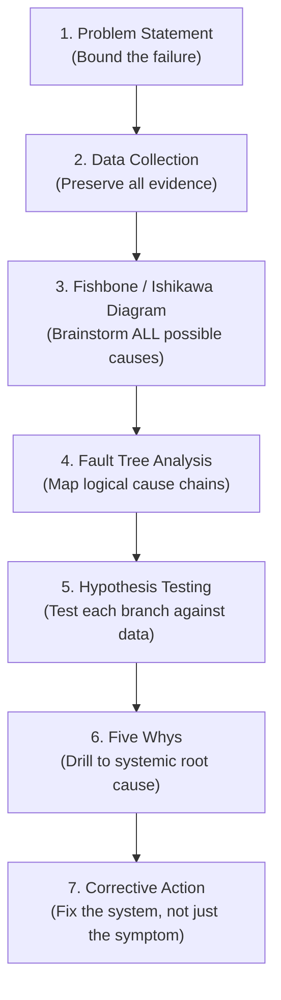
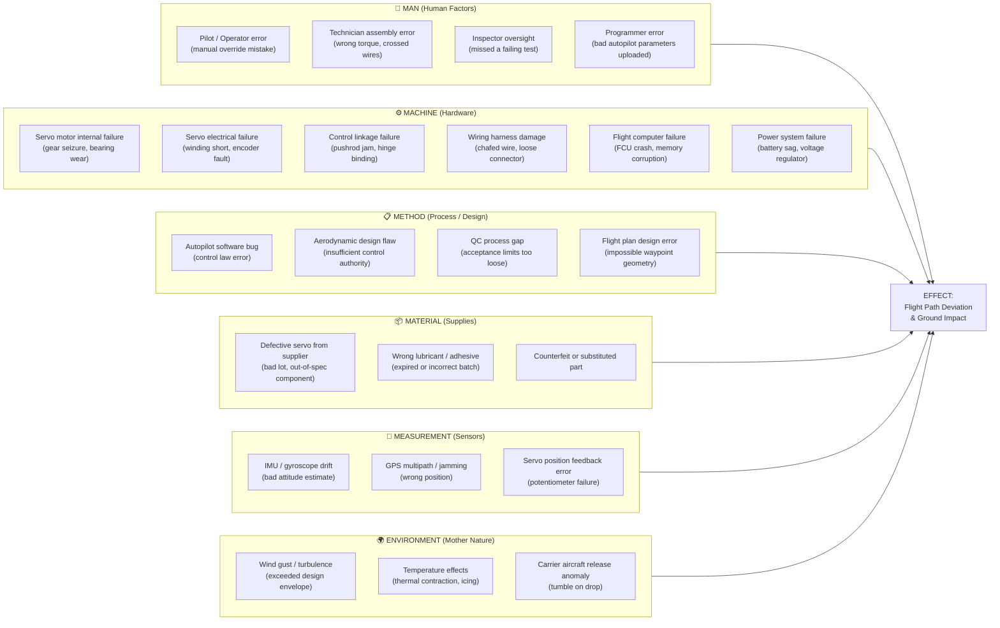
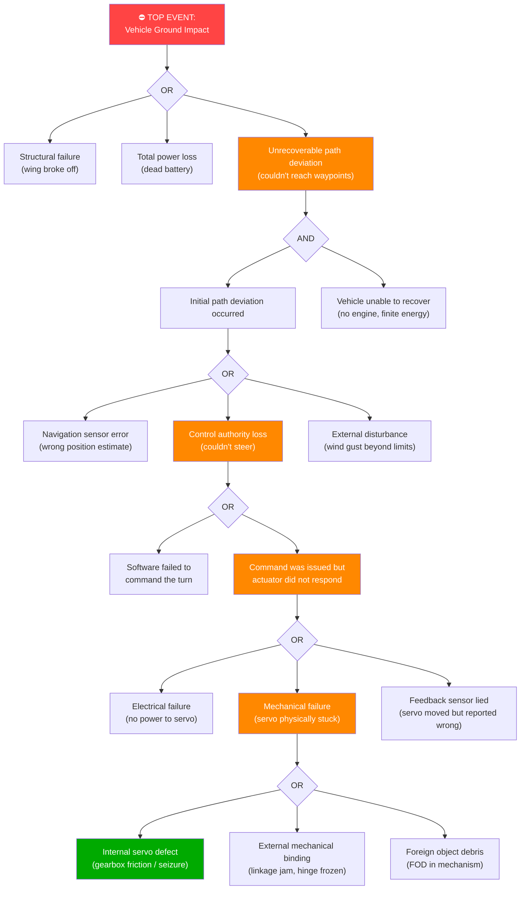
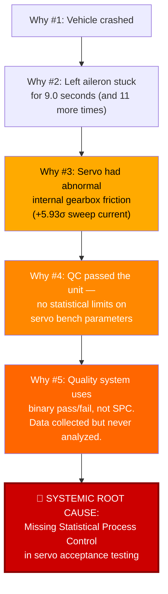

# Aerospace Root Cause Analysis: Flight FLT-2026-02-28-001

> **Revision 2026-10-13:** every figure in this document was re-checked against `telemetry.csv`, `flight_plan.csv`, and `manufacturing.csv`, and corrected where the earlier draft was wrong. The values are reproduced by `analysis/flight_investigation.py` and `analysis/manufacturing_analysis.py`. The final write-up is [`REPORT.md`](../REPORT.md).

## Methodology Overview

In aerospace failure investigation, you **never** jump straight to a conclusion. The industry uses a structured, systematic elimination process because:

1. **Confirmation bias kills people.** Engineering "suspects manufacturing" — but suspicion is not evidence. If you anchor on the wrong cause, you ship a "fix" that doesn't fix anything, and the next aircraft crashes too.
2. **Regulatory and liability standards** (FAA, DoD MIL-STD-882, NASA NPR 8621.1) require documented, traceable reasoning from observed symptom → physical mechanism → root cause → corrective action.
3. **Multiple causes can stack.** A crash is often not one thing — it's a chain of failures (the "Swiss Cheese Model"). You must map the full chain.

The standard aerospace RCA workflow is:



---

## Step 1: Problem Statement (Bounding the Failure)

> [!IMPORTANT]
> Before analyzing anything, define the failure precisely. A vague statement like "the flight failed" is useless. You need the **what, when, where, and how bad.**

### Formal Problem Statement

| Element | Detail |
|:---|:---|
| **What failed** | Vehicle GLDR-0421 deviated from planned flight path during autonomous glide test |
| **When** | Flight FLT-2026-02-28-001, February 28, 2026. Deviation began at $t = 246\text{ s}$ into flight |
| **Where** | Between Waypoint 02 ($t = 246\text{ s}$) and Waypoint 03 ($t = 292\text{ s}$) |
| **Severity** | Total loss of vehicle — ground impact at $t = 1198.9\text{ s}$ |
| **Pre-flight status** | All factory QC tests passed (`final_qc_pass = 1`), all pre-flight checks nominal |
| **What was expected** | Vehicle should have hit all 21 waypoints within 75 m tolerance during a descending loiter pattern |
| **What actually happened** | Hit WP-01 (1.21 m miss) and WP-02 (1.30 m miss) with precision, then missed WP-03 by 109.23 m and every subsequent waypoint by increasing margins up to 5,146 m. Descent rate stayed normal (no dive or stall); the vehicle glided on the wrong track and hit the ground about 5 km off course. The autopilot entered `FAILSAFE` (`NAV_PATH_DEVIATION`) at t = 1182 s as a result |

### Key Observation Before Analysis

The flight performed **perfectly** for the first 246 seconds. This is critical evidence:
- It rules out causes that would have been present from the start (e.g., a totally dead component, a fundamental design flaw in the airframe shape, or a catastrophic assembly error).
- Whatever went wrong was either **latent** (hidden until a specific condition triggered it) or **transient** (it came and went).

---

## Step 2: Data Collection (Evidence Inventory)

In aerospace investigation, you catalog every piece of evidence before touching analysis. This prevents cherry-picking.

### Available Evidence

| Source | Description | Size | Key Fields |
|:---|:---|:---|:---|
| [telemetry.csv](../telemetry.csv) | 500 Hz flight recorder data from the FCU (Flight Control Unit) | 600,000 rows × 100+ columns | Timestamps, GPS, attitude (roll/pitch/yaw), control commands vs actuals, servo currents, power rails, failsafe flags |
| [flight_plan.csv](../flight_plan.csv) | Planned waypoint sequence | 21 waypoints | Target positions, times, hit/miss results |
| [manufacturing.csv](../manufacturing.csv) | Factory build records for 200,000 vehicles | 200,000 rows × 140+ columns | Servo bench tests, assembly parameters, QC results, vendor/lot traceability |
| [telemetry-simulation.py](../telemetry-simulation.py) | 3D playback tool | — | Visual replay of the flight |

### Evidence Not Available (Gaps)

- **Physical wreckage inspection** (no post-crash teardown data)
- **Independent environmental data** (the only wind and temperature data is the vehicle's own estimate: `wind_est_speed_mps`, `outside_temp_c`)
- **Carrier aircraft release telemetry** (no data on whether the drop was clean)
- **Previous flight history** for this vehicle (first and only flight)

> [!NOTE]
> **Why gaps matter:** In a real investigation, you'd note these gaps explicitly because they limit which hypotheses you can fully confirm vs. only "not contradicted by available evidence." You work with what you have, but you acknowledge what you don't.

---

## Step 3: Fishbone (Ishikawa) Diagram — Brainstorm ALL Possible Causes

The Ishikawa diagram forces you to systematically consider **every category** of possible cause before looking at data. This is the antidote to tunnel vision.

In aerospace, the standard categories (the "bones" of the fish) are the **6M's**:

```
Man (Human)     Machine (Hardware)     Method (Process)
    \                  |                  /
     \                 |                 /
      \                |                /
       ─────────────── ● ───────────────  ← EFFECT: Flight Path Deviation
      /                |                \     & Ground Impact
     /                 |                 \
    /                  |                  \
Material (Supplies)  Measurement (Sensors)  Mother Nature (Environment)
```

### Full Ishikawa Expansion



> [!TIP]
> **For your assessment:** The Ishikawa diagram shows Andrew and the engineering team that you considered *everything* before narrowing down. This is what separates a rigorous analysis from "I looked at the data and it seemed like the servo was bad."

---

## Step 4: Fault Tree Analysis (FTA) — Logical Cause Chains

The Fishbone brainstorms possibilities. The **Fault Tree** maps logical dependencies: what combination of conditions would have to be true for the failure to occur?

The "Top Event" is the crash. We work backwards:



The orange path is the chain we'll test. The green node is where the evidence will land.

---

## Step 5: Systematic Hypothesis Testing (Evidence vs. Each Branch)

Now we take each Fishbone / Fault Tree branch and test it against the available data. **Every hypothesis gets a fair trial.**

---

### Hypothesis 1: Human / Operator Error

| Sub-Hypothesis | Evidence Test | Telemetry / Mfg Data Finding | Verdict |
|:---|:---|:---|:---|
| **Pilot override mistake** | Was the vehicle in manual control mode? | `control_mode = AUTO_STABILIZE` from release until t = 1182 s, when it switched to `FAILSAFE` (`NAV_PATH_DEVIATION`), 936 s *after* the deviation began. No manual override. | ❌ **Eliminated** — autonomous throughout the anomaly. The failsafe was a consequence, not a cause. |
| **Technician assembly error** (wrong linkage, crossed wires) | Check airframe assembly params in mfg data | `hinge_torque_nmm = 37.07` (fleet mean 54.99), `control_linkage_freeplay_mm = 0.276` (fleet mean 0.552), `servo_mount_screw_torque_nm = 0.692` (fleet mean 0.85). All within the fleet's normal range (\|Z\| < 2), and none points toward binding. | ❌ **Eliminated** — Assembly workmanship was within spec. |
| **Inspector missed a failing test** | Did QC flag anything? | `final_qc_pass = 1`, `qc_exception_count = 0`. But also: **100% of all 200,000 vehicles passed QC**, including **32,296 that had logged QC exceptions**. This means QC never stops *anything*. This is a process problem, not a one-off human error. | ⚠️ **Partially relevant** — Inspector didn't miss a flagged defect; the QC process itself doesn't have limits that would flag it. (Systemic issue, addressed in 5 Whys below.) |
| **Wrong firmware / parameters uploaded** | Check firmware and param profile | `firmware_loaded = FW-1.7.2`, `param_profile_id = PP-COAST`. Rework note: *"Updated firmware + parameter profile; repeated self-test."* (Code R05). R05 is a routine rework (9,571 units). It checks the software state, not the servo's mechanical health, so it was a missed chance to catch the defect, not evidence of masking. | ❌ **Eliminated** — Standard firmware, standard parameters. |

---

### Hypothesis 2: Design Flaw (Aerodynamic or Software)

| Sub-Hypothesis | Evidence Test | Finding | Verdict |
|:---|:---|:---|:---|
| **Autopilot software bug** | Did the software issue the correct commands? | From about $t = 246\text{ s}$ the roll setpoint ramps **smoothly** from about −1° through 0° up to +18.3° at 255 s, and `aileron_left_cmd_deg` follows it (up to about +18°). This is the same kind of command profile that flew the earlier left bank correctly, and the right aileron's command mirrors the left. | ❌ **Eliminated** — software issued correct, smooth commands. |
| **Insufficient control authority** (ailerons too small to turn the plane) | Did the plane successfully execute the same maneuver earlier? | From $t = 200\text{-}246\text{ s}$, the plane executed a $-20°$ left bank perfectly, hitting WP-02 within 1.3 m. The aerodynamic design has more than enough control authority for $±20°$ banks. | ❌ **Eliminated** — The identical maneuver worked 46 seconds earlier. |
| **Impossible flight plan** (waypoints too close or turns too aggressive) | Check waypoint geometry | Waypoints are spaced ~46 seconds apart with moderate bank angles ($±20°$). The vehicle hit WP-01 and WP-02 with sub-2-meter accuracy. The plan was achievable. | ❌ **Eliminated** — Flight plan was flyable; proven by WP-01 and WP-02 hits. |

---

### Hypothesis 3: Environmental / External Disturbance

| Sub-Hypothesis | Evidence Test | Finding | Verdict |
|:---|:---|:---|:---|
| **Wind gust / turbulence** | Check wind estimates and accelerometer data at $t = 246\text{ s}$ | Between 200 and 300 s: `wind_est_speed_mps` 0.9–3.7 m/s (light breeze). `accel_z_filt_mps2` 8.6–10.3 m/s² (near 1 g, no turbulence spikes). Roll error stayed at or below 0.08° from 200 s until the bank reversal began at 245.7 s. | ❌ **Eliminated** — Calm conditions, no gust signatures. |
| **Temperature / icing** | Check temperature at flight altitude | `outside_temp_c` 7.6–12.0 °C between 200 and 300 s (about 1,200 m above ground). Well above freezing. No icing conditions. | ❌ **Eliminated** — Too warm for ice. |
| **Bad release from carrier** | Check initial flight stability | From $t = 0\text{-}200\text{ s}$, the vehicle flew straight and level with near-zero roll error, hitting WP-01 within 1.21 m. The drop was clean. | ❌ **Eliminated** — Clean release, stable initial flight. |

---

### Hypothesis 4: Sensor / Measurement Error

| Sub-Hypothesis | Evidence Test | Finding | Verdict |
|:---|:---|:---|:---|
| **IMU / gyroscope drift** | Cross-check attitude estimates vs. GPS track | `attitude_valid = 1` throughout. Roll/pitch/yaw measurements are consistent with GPS ground track and accelerometer data. If the gyro were lying, the GPS track would diverge from the attitude estimate — it doesn't. | ❌ **Eliminated** — Attitude sensors were accurate. |
| **GPS error / jamming** | Check GPS health during anomaly | `gps_fix_type = 3` (3D fix) throughout, `gps_sats` 6–15, `gps_hdop` ≤ 1.01. No position jumps or outages. | ❌ **Eliminated** — GPS was healthy. |
| **Servo position feedback lied** (servo actually moved but potentiometer said it didn't) | Cross-check servo feedback against vehicle roll response | If the servo had actually moved but reported incorrectly, the aircraft *would have rolled right* (because the physical surface would be deflected). But before breakaway `roll_deg` peaked at only $+6.8°$ against a $+18.3°$ setpoint. The aircraft's physical behavior confirms the surface was truly stuck. | ❌ **Eliminated** — Physical roll response confirms the surface did not move. |

---

### Hypothesis 5: Electrical / Power Failure

| Sub-Hypothesis | Evidence Test | Finding | Verdict |
|:---|:---|:---|:---|
| **Battery voltage sag** | Check power rails during anomaly | During the event (246–255 s) `battery_voltage_v` stayed at 12.21–12.48 V and `battery_soc_pct` at 94–97%. No voltage drop. | ❌ **Eliminated** |
| **Servo bus brownout** | Check servo power bus | `servo_bus_voltage_v` ≥ 12.26 V during the event, `brownout_flag = 0` throughout. | ❌ **Eliminated** |
| **Wiring harness / connector failure** | Check if right aileron (same bus) worked | The right aileron tracked its command within 1.3° throughout the anomaly window. Both ailerons share the same power bus. If the bus failed, *both* would stop, not just one. | ❌ **Eliminated** — Differential failure (one side only) rules out shared electrical cause. |

---

### Hypothesis 6: Mechanical Hardware Failure (THE SURVIVING HYPOTHESIS)

| Sub-Hypothesis | Evidence Test | Finding | Verdict |
|:---|:---|:---|:---|
| **Left aileron servo internal defect** | Compare commanded vs. actual position | As the command reversed direction and climbed to about +16–18°, `aileron_left_actual_deg` stayed between roughly 0° and −11° for **9.0 seconds** ($t = 246.1\text{ s}$ to $255.1\text{ s}$), with the gap reaching 27.8°. The right aileron tracked within 1.3° over the same period. Sticking **recurred 11 more times** later in the flight (292–940 s, episodes of at least 0.5 s, gaps up to 18°). | ✅ **Consistent** |
| **Servo broke free suddenly** (stiction release signature) | Look for sudden snap in position data | At $t ≈ 255.1\text{ s}$: position jumps from $-9.6° \to +16.6°$ in about 100 ms, then tracks the command normally. Classic mechanical breakaway after sustained static friction. | ✅ **Consistent** |
| **Manufacturing bench data shows pre-existing defect** | Compare GLDR-0421's servo QC data to the fleet of 200,000 | Sweep current: **332.7 mA** (fleet mean 185.12, **+5.93σ**, highest of 200,000). Peak current: **400.3 mA** (fleet mean 260.08, +4.05σ, also highest). Sweep time: **940.9 ms** (fleet mean 780.04, +2.92σ). Position error RMS: **1.128°** (fleet mean 0.553, +2.98σ). Only **2 vehicles out of 200,000** exceeded 300 mA sweep current: GLDR-0421 and GLDR-200000 (304.2 mA). | ✅ **Confirmed** |
| **External linkage jam** (pushrod or hinge binding, not the servo itself) | Check hinge torque and linkage freeplay in mfg data | Hinge torque: 37.07 N·mm (fleet mean 54.99, so actually *looser* than average). Linkage freeplay: 0.276 mm (normal). Screw torque: 0.692 N·m (normal). | ❌ Linkage and hinge were fine — the defect is **internal to the servo motor**. |

---

## Step 6: The Five Whys — Drilling to Systemic Root Cause

The Five Whys technique asks "why?" repeatedly until you reach the systemic failure — the organizational or process breakdown that allowed the defect to reach the field.

> [!IMPORTANT]
> The Five Whys is not about the physics (we've already established that). It's about **why the system allowed it to happen.** This is what separates an operations engineer from a bench technician.

```
WHY #1: Why did GLDR-0421 crash?
  → Because the vehicle deviated from its flight path and, as an unpowered
    glider with no engine, could not recover the accumulated position error.

WHY #2: Why did it deviate from the flight path?
  → Because the left aileron actuator mechanically stuck for 9.0 seconds
    during a commanded bank reversal at t = 246s, preventing the vehicle
    from executing its planned right turn toward WP-03. It stuck again
    11 more times later in the flight.

WHY #3: Why did the left aileron actuator seize?
  → Because the servo motor (ActuMax SM-14, SN SV-65031081, Lot L2026-07B)
    had abnormally high internal gearbox friction. On the factory bench, it
    drew 332.7 mA sweep current (5.93σ above fleet mean), indicating the
    motor was fighting excessive mechanical resistance. Under dynamic
    aerodynamic loading at 25–29 m/s airspeed, the total resistance exceeded
    the motor's running torque, causing a temporary gear seizure (stiction).

WHY #4: Why was a servo with 5.93σ abnormal friction installed on a flight vehicle?
  → Because the Quality Control acceptance process does not have statistical
    limits on servo bench test parameters. The QC station records sweep
    current, sweep time, peak current, and backdrive torque — but none of
    them affects the pass decision. (Likely mechanism, to be confirmed
    with the quality team: the gate only checks that the servo completed
    the sweep without a hardware fault code.) There is no upper specification
    limit (USL) or statistical process control (SPC) rule that would
    reject a servo drawing 332.7 mA when the fleet average is 185 mA.

    Evidence: final_qc_pass = 1 for ALL 200,000 vehicles in the database,
    including 32,296 with logged QC exceptions. The QC system has never
    rejected a single unit.

WHY #5: Why doesn't the QC process have statistical limits?
  → Because the quality system was designed around binary functional testing
    ("does it work at all?") rather than parametric performance screening
    ("does it work WELL ENOUGH to survive flight loads?"). The factory
    collects the right data (the columns exist in manufacturing.csv) but
    has no automated rules, thresholds, or alerting built on top of that
    data. The data is recorded but never analyzed.

    This is the SYSTEMIC ROOT CAUSE.
```

### Visual Summary of the Five Whys Chain



---

## Step 7: Classification of Cause

Using the standard aerospace failure classification taxonomy:

| Classification Level | Finding |
|:---|:---|
| **Proximate Cause** (the physical thing that broke) | Left aileron servo motor internal mechanical seizure under aerodynamic load |
| **Contributing Cause** (what made it worse) | Unpowered glider has zero margin — no engine to recover from a 9-second control loss |
| **Escape path** | GLDR-200000 carries the same bench signature (304.2 mA, +4.78σ) and is still unscreened |
| **Root Cause** (why it reached the field) | Quality acceptance testing lacks Statistical Process Control; servo bench test data is collected but not evaluated against statistical limits |
| **Systemic Cause** (organizational) | Binary pass/fail quality culture — "did it complete the test?" rather than "is it performing within the population norm?" |

---

## Summary: Why This Was Manufacturing (Not Design, Not Pilot, Not Environment)

The structured elimination process conclusively points to **manufacturing / component defect** as the root cause:

| Factor | Status | Key Evidence |
|:---|:---|:---|
| Human / Pilot Error | ❌ Eliminated | Autonomous throughout the anomaly; `FAILSAFE` only at 1182 s as a consequence |
| Software / Design Flaw | ❌ Eliminated | Software issued smooth, correct commands; a ±20° bank succeeded 46 s earlier |
| Environmental | ❌ Eliminated | Light winds (0.9–3.7 m/s), no icing (7.6–12.0 °C), clean drop |
| Sensor / Measurement | ❌ Eliminated | GPS healthy, attitude valid, physical roll response confirms sensor readings |
| Electrical / Power | ❌ Eliminated | Power rails nominal, right aileron (same bus) worked fine |
| **Mechanical / Manufacturing** | **✅ Confirmed** | Left aileron servo drew +5.93σ current on the factory bench; stuck under flight loads 12 times; QC had no limits to catch it |

> [!CAUTION]
> **The systemic issue is bigger than one servo.** The QC system has passed 200,000 vehicles with zero rejections, and at least one more vehicle (GLDR-200000) carries the same signature. The data to detect outliers already exists in `manufacturing.csv` — it's just not being used. The corrective action is not "replace one servo." It's "build automated SPC screening into the quality gate so no out-of-spec actuator ever reaches a flight vehicle again." See `REPORT.md` §6 for the two-tier gate design.
